# KANT MOA — 아이돌 공식 굿즈샵

> 아이돌 11팀의 굿즈를 한곳에서 모아 보는 온라인 굿즈샵입니다. 가상 그룹 3팀 **ORBIT:ON(오르빗온) · DAYLOG(데이로그) · SODA FM(소다에프엠)** 과, 시연용으로 넣은 실제 아티스트 8팀(CORTIS · ZICO · BTS · SEVENTEEN · LE SSERAFIM · TOMORROW X TOGETHER · TWS · BOYNEXTDOOR)의 상품을 다룹니다.
> 팬이 메인에서 아티스트와 신상품을 둘러보고, 카테고리·아티스트별 목록에서 상품을 찾고, 상세 페이지에서 옵션(멤버·버전·사이즈)을 골라 장바구니에 담거나 바로 구매하는 흐름을 구현했습니다.

- **배포**: https://kant-moa.vercel.app
- **Use Case**: 의류/패션 편집숍형 쇼핑몰을 응용한 아이돌 굿즈 스토어
- **규모**: 아티스트 11팀 · 상품 387개(옵션 642개) · 카테고리 7개 (앨범, 응원용품, 인형, 액세서리, 의류, 생활용품, 멤버십)
- **팀**: KANT_MOA (4명) · 개발 기간 2026.10.07 ~ 10.13 (7일)

> **저작권 고지** — 비상업적 학습·시연용 프로젝트이며 실제 판매·결제는 이루어지지 않습니다. 실제 아티스트 8팀의 이름, 로고, 상품 이미지와 메인 배너 영상(`public/sources/`의 공식 뮤직비디오 티저)의 저작권은 각 소속사에 있습니다. 해당 상품의 이름·가격·옵션은 시연을 위해 임의로 정했으며 실제와 다릅니다. 이 프로젝트는 각 아티스트·소속사와 관계가 없습니다.

---

## 목차

1. [주요 기능](#1-주요-기능)
2. [기술 스택](#2-기술-스택)
3. [실행 방법](#3-실행-방법)
4. [화면 구성](#4-화면-구성)
5. [컴포넌트 구조도](#5-컴포넌트-구조도)
6. [폴더 구조](#6-폴더-구조)
7. [데이터 구조 (ERD)](#7-데이터-구조-erd)
8. [데이터 연동 방식](#8-데이터-연동-방식)
9. [과제 요구사항 대응](#9-과제-요구사항-대응)
10. [팀원과 역할](#10-팀원과-역할)
11. [협업 방식](#11-협업-방식)
12. [트러블슈팅](#12-트러블슈팅)

---

## 1. 주요 기능

| 영역 | 기능 |
|---|---|
| 둘러보기 | 메인(아티스트별 배너·영상 슬라이드, Recommended Artist, 아티스트별 굿즈), 아티스트 목록, 아티스트 페이지(배너·상품·공지·멤버 소개), 카테고리별 목록, 정렬(최신순·가격순), 더보기, 최근 본 상품 |
| 상품 상세 | 대표·상세 이미지, 옵션 선택(멤버·버전·사이즈, 추가금), 수량 선택, 품절·1인 구매 제한 안내, 장바구니 담기·바로 구매, 없는 상품 ID는 404 처리 |
| 장바구니 | 비회원도 담기 가능(브라우저 저장), 로그인하면 서버 장바구니로 자동 병합, 수량 변경·삭제, 품절 상품은 합계에서 제외, 배송비(5만 원 이상 무료) |
| 주문·결제 | 주문서(기본 배송지 자동 입력, 배송지 선택·추가), 테스트 결제, 결제 완료·주문 상세, 다시 결제, 주문 취소(재고 복구) |
| 마이페이지 | 주문/취소 내역(상태 탭), 배송 주소 관리(추가·수정·삭제·기본 지정), 내 정보 수정, 로그아웃 |
| 회원 | 회원가입, 로그인, 로그인 후 원래 보던 화면으로 돌아가기 |
| 공지 | 아티스트별 공지 목록·상세, 관련 상품 바로가기 |
| 칸트봇 | 상품·배송 문의에 답하는 AI 챗봇 (Google Gemini, 서버에서만 호출) |
| 반응형 | 상품 그리드 2→3→4열, 모바일 햄버거 메뉴, 모바일 전용 글자·여백 크기 |

> 실제 결제는 이루어지지 않습니다. "결제하기"를 누르면 결제 완료로 처리되는 **가짜 결제**입니다.

---

## 2. 기술 스택

| 영역 | 사용 기술 |
|---|---|
| 프레임워크 | Next.js 16 (App Router, `cacheComponents`), React 19 |
| 언어 | TypeScript 5 |
| 스타일 | Tailwind CSS 4 |
| 백엔드 (BaaS) | Supabase — Auth, Postgres, RLS(행 단위 권한), RPC(DB 함수), Storage |
| AI | Google Gemini (칸트봇, `GEMINI_API_KEY`는 서버 전용) |
| 테스트 · CI | Node 내장 테스트(`node:test`), GitHub Actions (린트 · 타입 검사 · 테스트) |
| 배포 | Vercel (`main` 배포, PR마다 미리보기 배포) |
| 협업 | GitHub (Issues · PR), Redmine, Notion, Slack |

---

## 3. 실행 방법

### 준비물

- Node.js 20 이상(테스트는 22.18 이상), npm
- Supabase 프로젝트의 URL과 Publishable(anon) 키

### 로컬 실행

```bash
git clone https://github.com/jin-park0115/KANT_MOA.git
cd KANT_MOA
npm install
cp .env.example .env.local
```

`.env.local`에 값을 넣습니다. (팀원은 팀 채널에서 공유받은 값을 사용합니다.)

```bash
NEXT_PUBLIC_SUPABASE_URL=https://<project-ref>.supabase.co
NEXT_PUBLIC_SUPABASE_PUBLISHABLE_KEY=<publishable 또는 anon key>
GEMINI_API_KEY=<선택: 칸트봇을 쓸 때만>
```

```bash
npm run dev        # http://localhost:3000
```

### 그 밖의 명령어

```bash
npm run build      # 프로덕션 빌드
npm run start      # 빌드 결과 실행
npm run lint       # ESLint
npm run typecheck  # 타입 검사 (tsc --noEmit)
npm test           # 단위 테스트 (tests/*.test.ts)
```

### 직접 Supabase 프로젝트를 만들어 실행하는 경우

1. Supabase에서 새 프로젝트를 만들고 URL·키를 `.env.local`에 넣습니다.
2. `supabase/migrations/`의 SQL을 **파일 이름 순서대로** 적용합니다. (Supabase CLI의 `supabase db push` 또는 SQL Editor)
3. `supabase/seed.sql`로 아티스트·카테고리·샘플 상품을 넣습니다.
   - `..._add_artist_members.sql`, `..._add_daylog_sodafm_products.sql`은 seed의 아티스트·카테고리가 있어야 데이터가 들어갑니다. 빈 DB라면 seed를 먼저 넣고 두 파일을 다시 실행하세요.
4. Storage의 `products`, `artists` 버킷에 이미지를 올립니다. (경로 규칙: `docs/DB_DESIGN.md`)

> `.env.local`은 커밋하지 않습니다. service role(secret) 키는 이 프로젝트에서 사용하지 않습니다.

---

## 4. 화면 구성

| 화면 | 경로 | 비고 |
|---|---|---|
| 메인 | `/` | 배너·영상 슬라이드, Recommended Artist, 아티스트별 굿즈 캐러셀 |
| 아티스트 목록 | `/artists` | 11팀 |
| 아티스트 | `/artists/[slug]` | 배너, 카테고리 탭, 상품 목록, 공지 |
| 아티스트 소개 | `/artists/[slug]/about` | 멤버 카드 (멤버 정보가 있는 팀만 연결) |
| 공지 상세 | `/artists/[slug]/notices/[id]` | 관련 상품 보러가기, 다른 공지 |
| 전체 상품 | `/products` | 전체 상품 목록, 정렬, 더보기 |
| 카테고리 목록 | `/category/[slug]` | 카테고리 탭, 정렬, 더보기 |
| 상품 상세 | `/products/[id]` | 동적 라우트, 없는 ID는 404 |
| 최근 본 상품 | `/recently-viewed` | 브라우저에 최대 20개 저장 |
| 장바구니 | `/cart` | 비회원 가능 |
| 주문서 | `/checkout` | 로그인 필요, `?variant=&qty=`면 바로 구매 |
| 주문/취소 내역 | `/orders` | `?status=paid·pending·cancelled` 탭 |
| 결제 완료·주문 상세 | `/orders/[id]` | 다시 결제, 주문 취소 |
| 마이페이지 | `/mypage` | 메뉴 |
| 배송 주소 관리 | `/mypage/addresses` | |
| 내 정보 수정 | `/mypage/profile` | |
| 로그인 / 회원가입 | `/login`, `/signup` | `?next=` 로 원래 화면 복귀 |

### 사용자 흐름

```
메인 ─┬─ 아티스트 페이지 ─┐                   ┌─ 장바구니 ─┐
      ├─ 카테고리 목록 ───┼─▶ 상품 상세 ─────┤            ├─▶ (로그인) ─▶ 주문서 ─▶ 결제 ─▶ 주문 상세
      └─ 최근 본 상품 ────┘                   └─ 바로 구매 ┘                                    │
                                                              마이페이지 ◀─ 주문/취소 내역 ◀──┘
```

### 완성 화면

2026.10.13 화면입니다. 계정 정보(이름·전화번호·주소)는 테스트용 예시 값입니다.

| 메인 | 아티스트 페이지 |
|---|---|
| 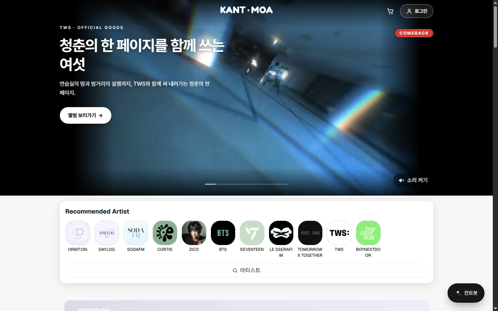 | 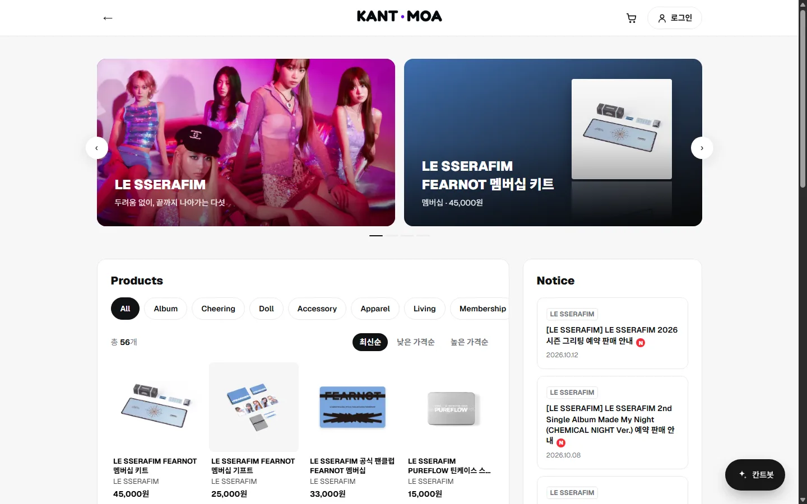 |

| 상품 상세 | 장바구니 |
|---|---|
| 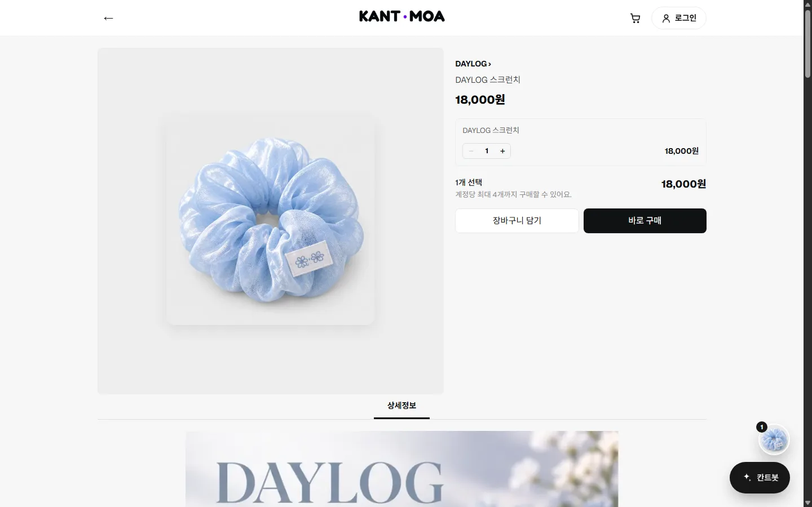 | 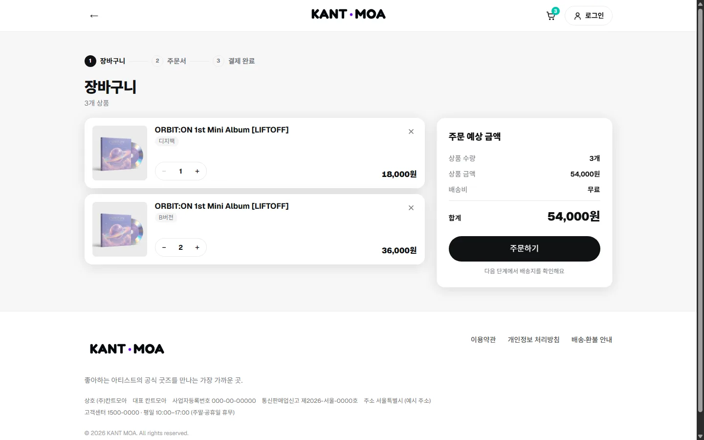 |

| 주문서 | 마이페이지 |
|---|---|
| 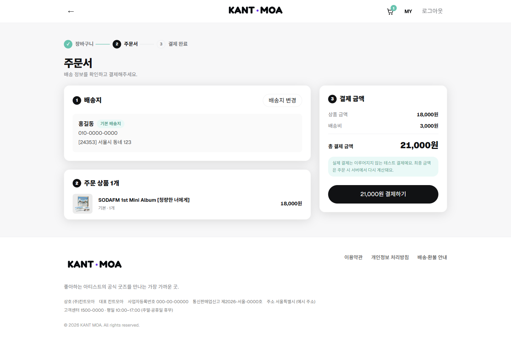 | 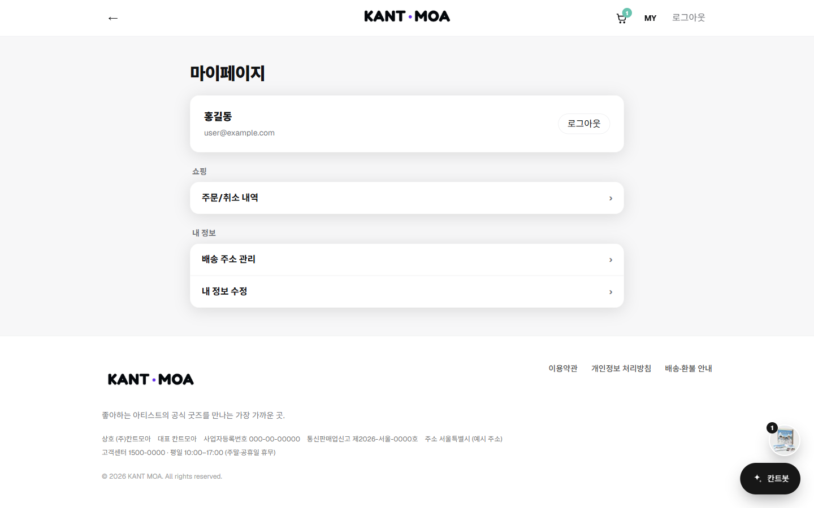 |

**모바일**

| 메인 | 메뉴 | 아티스트 | 상품 상세 |
|---|---|---|---|
| 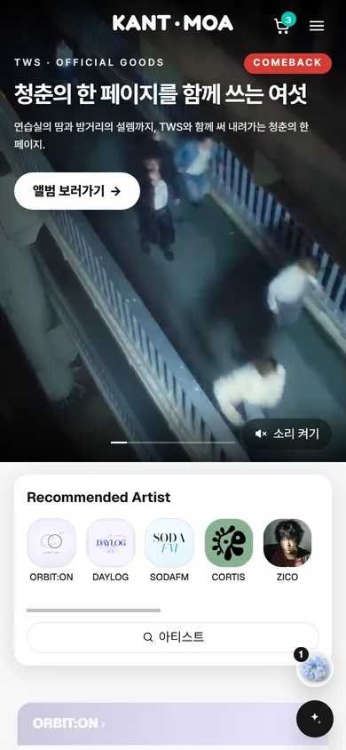 | 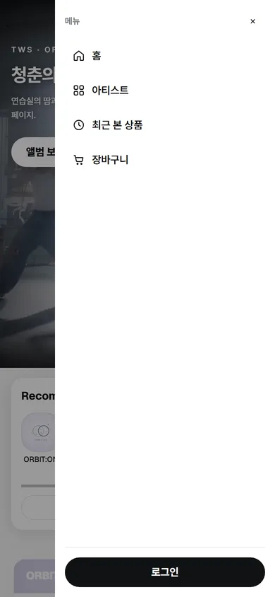 | 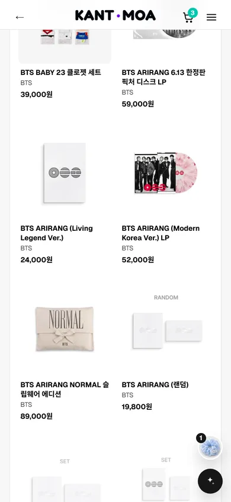 | 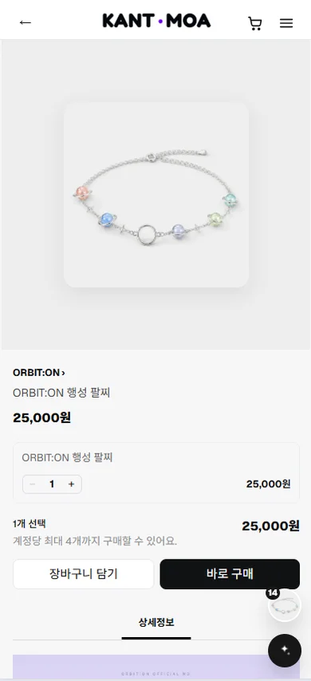 |

| 로그인 | 주문서 | 결제 완료 |
|---|---|---|
| 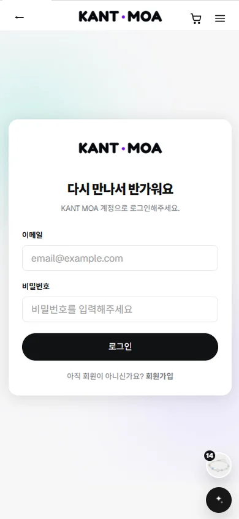 | 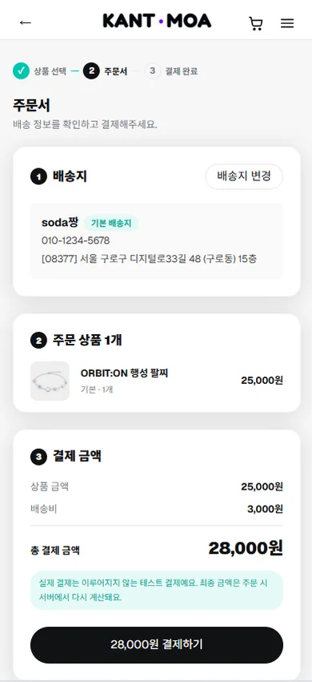 | 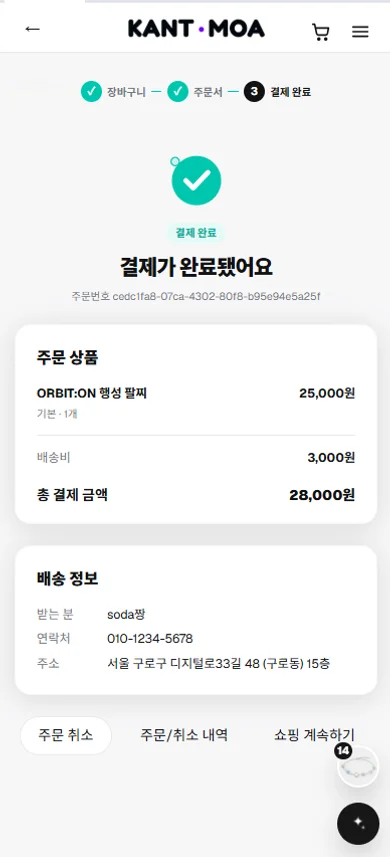 |

---

## 5. 컴포넌트 구조도

```
RootLayout (app/layout.tsx)
├─ AuthProvider                         로그인 상태 구독 (비회원 장바구니 자동 병합)
├─ (그룹 레이아웃이 그림) TopBar          뒤로 가기 · 로고 · 장바구니 · 로그인 · 모바일 햄버거 메뉴(MobileMenu)
│                                       (home)은 배너 안에, (shop)·(auth)는 흰색 헤더로
├─ <main> (각 페이지)
├─ Footer                               사업자 정보 (shop_settings)
└─ FloatingButtons                      최근 본 상품 · 칸트봇 (장바구니·주문서는 둘 다, 상품 상세는 최근 본 상품만 숨김)

메인 /
├─ HomeSpotlight                        배너·영상 슬라이드, 진행 막대, 무한 루프
├─ ArtistPicker                         Recommended Artist
└─ ArtistShowcase (아티스트마다) ─ ProductCarousel ─ ProductCard

아티스트 /artists/[slug]
├─ ArtistBanners ─ ArtistBannerCarousel
├─ ArtistCategoryTabs + ProductListSection ─ SortTabs, ProductGrid ─ ProductCard
└─ ArtistNotices ─ NoticeTrack          모바일은 가로 슬라이드

아티스트 소개 /artists/[slug]/about
└─ MemberGallery ─ MemberCard

카테고리 /category/[slug]
└─ ProductListSection ─ SortTabs, ProductGrid ─ ProductCard

상품 상세 /products/[id]
└─ ProductPurchasePanel
   ├─ OptionSelector
   ├─ QuantityStepper
   └─ 장바구니 담기 (useCart) · 바로 구매

장바구니 /cart
└─ CartItemRow ─ QuantityStepper        (useCart, useShippingFee)

주문서 /checkout
├─ CheckoutItems · CheckoutSummary · CheckoutAddressCard
└─ AddressPickerModal ─ AddressForm     배송지 변경·추가

주문/취소 내역 /orders, 주문 상세 /orders/[id]
└─ OrderList / OrderDetail ─ OrderStatusBadge

마이페이지 /mypage, /mypage/profile, /mypage/addresses
└─ AddressForm, AddressSummary

로그인 / 회원가입
└─ AuthShell ─ LoginForm / SignupForm

공용 UI (components/ui)
Button · Input · Card · Badge · Modal · EmptyState · SectionHeader · Skeleton · PageTitle
(로그인이 필요한 화면은 LoginRequired, 불러오기 실패는 LoadError)
```

---

## 6. 폴더 구조

```
KANT_MOA/
├─ .github/                 CI(GitHub Actions) · PR 템플릿
├─ docs/                    설계·협업 문서 (SETUP, FRONTEND, BACKEND, DB_DESIGN, API_SPEC, worklog), screenshots
├─ public/
│  ├─ brand/                로고 등 고정 이미지
│  └─ sources/              메인 배너 영상 (저작권 고지 참고)
├─ supabase/
│  ├─ migrations/           테이블 · RLS · RPC · Storage · 상품 데이터 마이그레이션 (순서대로 적용)
│  └─ seed.sql              아티스트 · 카테고리 · 샘플 상품
├─ tests/                   단위 테스트 (배송비 · 목록 파라미터 · 배송지 검증)
└─ src/
   ├─ app/
   │  ├─ (home)/            메인 (헤더가 배너 안에 있음)
   │  ├─ (shop)/            아티스트 · 카테고리 · 상품 · 최근 본 상품 · 장바구니 · 주문 · 마이페이지
   │  ├─ (auth)/            로그인 · 회원가입
   │  ├─ api/chat/          칸트봇 API (Gemini는 서버에서만 호출)
   │  └─ layout.tsx         공통 레이아웃
   ├─ components/
   │  ├─ layout/            TopBar · Header · Footer · MobileMenu · FloatingButtons
   │  ├─ ui/                공용 UI
   │  ├─ home/              메인 배너 · Recommended Artist · 아티스트별 굿즈
   │  ├─ artist/            아티스트 배너 · 공지 · 멤버 카드
   │  ├─ product/           상품 카드 · 그리드 · 상세 구매 패널 · 최근 본 상품
   │  ├─ cart/ · order/ · address/ · auth/ · chatbot/ · providers/
   ├─ hooks/                useCart(장바구니 공유 상태) · useShippingFee
   ├─ services/             Supabase 호출 함수 (프론트는 여기만 사용), fallback.ts(DB 장애 시 대체)
   ├─ data/                 products.ts(정적 상품 47개, 가상 3팀) · catalog.ts(아티스트·카테고리)
   ├─ lib/                  Supabase 클라이언트 · 칸트봇 · formatPrice · shipping
   ├─ constants/            에러 메시지
   └─ types/                app.ts(화면용 타입), product.ts(과제 규격 Product), database.ts(DB 자동 생성 타입)
```

---

## 7. 데이터 구조 (ERD)

상품 데이터는 **Supabase(Postgres)** 에 저장하고, 과제 규격의 정적 데이터도 함께 둡니다.

- `src/types/product.ts`: 과제 규격 `interface Product` (`id`, `name`, `price`, `category`, `imageUrl`, `description`, `isNew?`)
- `src/data/products.ts`: 가상 3팀 상품 47개를 옮겨 적은 정적 배열 (옵션·재고 포함), `src/data/catalog.ts`: 아티스트·카테고리
- 평소에는 DB를 쓰고, **DB 조회가 실패하면 정적 데이터로 같은 화면을 그립니다** (아래 8장). 정적 데이터에는 나중에 추가한 실제 아티스트 8팀이 없습니다.
- 화면에서 쓰는 타입은 `src/types/app.ts`의 `ProductSummary` / `ProductDetail`입니다.

DB 테이블은 16개입니다. 아래는 핵심 관계이고, 이 밖에 `artist_banners`(아티스트 배너), `home_banners`(메인 배너), `notices`(공지), `wishlists`(찜), `shop_settings`(배송비·사업자 정보)가 있습니다.

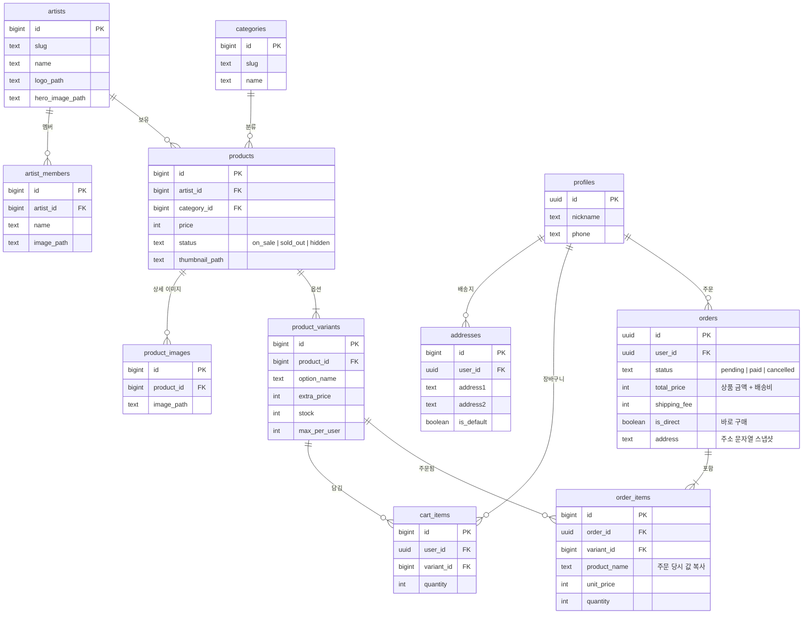

- **재고·구매 제한은 옵션(variant) 단위**로 관리합니다. 옵션이 없는 상품도 '기본' 옵션 1개를 가집니다.
- **주문은 스냅샷**입니다. 상품명·옵션명·가격·배송지를 주문 시점 값으로 복사해, 나중에 상품이나 주소록이 바뀌어도 지난 주문은 그대로입니다.
- 이미지는 Storage에 저장하고 DB에는 **버킷 안의 경로**만 저장합니다.

자세한 정책과 SQL은 [`docs/DB_DESIGN.md`](docs/DB_DESIGN.md)를 참고하세요.

---

## 8. 데이터 연동 방식

별도 API 서버 없이, 컴포넌트는 **`src/services/`의 함수만** 호출하고 그 안에서 Supabase를 사용합니다. (칸트봇만 `app/api/chat` 서버 라우트를 거칩니다.)

```
[컴포넌트] ──▶ services/*.ts ──▶ Supabase
                                 ├─ 조회: 테이블 select (RLS로 보호)
                                 ├─ 장바구니: cart_items (본인 것만)
                                 └─ 주문·결제·취소·바로 구매·기본 배송지: RPC (DB 함수)
```

**DB 장애 대비**: 상품·아티스트·카테고리 조회(`getArtists`, `getArtist`, `getCategories`, `getProducts`, `getProduct`)가 실패하면 `services/fallback.ts`가 `src/data/`의 정적 데이터로 같은 반환 형태를 만들어 줍니다. 서버 로그에 `[fallback]` 경고가 남습니다. 둘러보기(메인·목록·상세)는 계속 동작하고, 장바구니(로그인)·주문·결제처럼 DB가 꼭 필요한 기능은 대체하지 않습니다.

| 파일 | 주요 함수 |
|---|---|
| `artists.ts` | `getArtists`, `getArtist`, `getArtistMembers`, `getArtistBanners` |
| `products.ts` | `getCategories`, `getProducts`, `getProduct`, `searchProducts`, `getBestProducts`, `getHomeBanners` |
| `notices.ts` | `getNotices`, `getNotice`, `getTopbarNotice` |
| `auth.ts` | `signUp`, `signIn`, `signOut`, `getProfile`, `updateProfile`, `onAuthChange` |
| `cart.ts` | `getCart`, `addToCart`, `updateQuantity`, `removeFromCart`, `getDirectItem` — 비로그인은 브라우저, 로그인은 DB를 같은 함수로 처리 |
| `orders.ts` | `createOrder`, `createDirectOrder`, `payOrder`, `cancelOrder`, `getOrders`, `getOrder` |
| `addresses.ts` | `getAddresses`, `createAddress`, `updateAddress`, `deleteAddress`, `setDefaultAddress` |
| `settings.ts` | `getShopSettings`, `calcShippingFee` |

**보안 원칙**
- 카탈로그는 누구나 읽기만 가능하고, 장바구니·주문·배송지는 **본인 데이터만** 접근할 수 있습니다 (RLS).
- 가격·재고·구매 제한·배송비가 걸린 쓰기(`create_order`, `create_direct_order`, `pay_order`, `cancel_order`)는 **DB 함수에서만** 처리합니다. 결제 금액은 클라이언트가 보낸 값이 아니라 DB가 계산합니다.
- 칸트봇의 Gemini 키는 서버에만 있고, 주문·개인정보는 챗봇에 보내지 않습니다.

전체 명세: [`docs/API_SPEC.md`](docs/API_SPEC.md)

---

## 9. 과제 요구사항 대응

| No. | 요구사항 | 구현 내용 |
|---|---|---|
| 1 | 기획 및 범위 정의 | 아이돌 굿즈샵, 메인·목록·상세 + 장바구니·주문 흐름 |
| 2 | 개발 환경 | Next.js(App Router) + TypeScript + Tailwind CSS |
| 3 | 데이터 모델링 | `src/types/product.ts`(과제 규격 `Product`) + `src/data/products.ts`(상품 47개, DB 장애 시 대체 데이터). 실제 저장은 Supabase DB(16개 테이블, 상품 387개) |
| 4 | 공통 컴포넌트 | `Header`(TopBar), `Footer`, `ProductCard` + 공용 UI 9종 |
| 5 | 목록 동적 렌더링 | `ProductGrid`에서 `.map()`으로 카드 출력 (`/category/[slug]`, `/artists/[slug]`, 메인) |
| 6 | 상세 동적 라우팅 | `app/(shop)/products/[id]/page.tsx` |
| 7 | 클라이언트 네비게이션 | `next/link`의 `<Link>`로 페이지 이동 |
| 8 | 스타일링 | Tailwind Grid/Flex, `aspect-square` · `object-cover`, hover 효과(마우스 기기에서만) |
| 9 | 예외 처리 · 저장소 | 없는 상품 ID는 `notFound()`, `.gitignore`로 `node_modules` · `.next` · `.env*.local` 제외 |
| 10 | 문서화 · 발표 | 이 README, `docs/` 설계 문서 |

| 도전 과제 | 구현 내용 |
|---|---|
| A. 반응형 | 상품 그리드 2→3→4열, 모바일 햄버거 메뉴, 모바일 전용 크기 조정 |
| B. 장바구니 | 장바구니 담기·수량·삭제 + 주문·결제·바로 구매·주문 내역까지 확장 |
| C. Vercel 배포 | 완료 — https://kant-moa.vercel.app (PR마다 미리보기 배포) |

> 과제의 제외 범위(DB, 로그인, 서버 장바구니)를 팀 목표에 맞춰 **확장 구현**했습니다. 필수 화면(메인·목록·상세)은 그대로 충족합니다.

---

## 10. 팀원과 역할

| 이름 | 역할 | 담당 |
|---|---|---|
| 황지나 (jina) | 프론트엔드 A | 공통 레이아웃(헤더·푸터·내비), 공용 UI, 디자인 토큰, 로그인·회원가입 |
| 장충만 (chungman) | 프론트엔드 B | 메인, 아티스트 페이지, 카테고리·상품 목록, 상품 상세, 메인 배너 |
| 최성호 (sungho) | 프론트엔드 C | 장바구니(`useCart`), 주문서·바로 구매, 결제 완료·주문 상세, 주문/취소 내역, 마이페이지·배송지 관리 |
| 박진 (jin) | 백엔드 | Supabase 스키마 · RLS · RPC, `services/`, Storage·상품 데이터, 배송비·공지, 칸트봇 API, 배포·저장소 관리 |

---

## 11. 협업 방식

- **브랜치**: `main`(배포) ← `develop`(통합) ← `dev/<이름>`(개인). 작업 전 매번 `develop`을 개인 브랜치에 병합
- **PR**: 기능 단위로 `dev/<이름>` → `develop`, 머지 커밋(merge commit)으로 합칩니다. `develop` → `main` PR이 배포입니다.
  - 충돌 해결이나 배포 머지가 급할 때 저장소 관리자(jin)가 다른 팀원 브랜치의 PR을 대신 열고 머지한 경우가 있어, GitHub의 PR 작성자 수는 실제 기여와 다를 수 있습니다. 실제 작업 내용은 각자의 `docs/worklog/<이름>.md`에 남겼습니다.
  - 개발 초반에는 GitHub 리뷰 승인 없이 머지한 PR이 많습니다. 2026.10.13부터 아래 규칙을 적용했습니다.
- **PR 규칙 (2026.10.13~)**: PR 템플릿(`.github/pull_request_template.md`)으로 변경 내용·확인 항목 작성, GitHub Actions CI(린트 · 타입 검사 · 테스트) 통과, `main`은 PR로만 머지(브랜치 보호)
- **담당 영역 분리**: 다른 사람 담당 파일·공용 파일(`layout.tsx`, `globals.css`, `package.json` 등)은 합의 후 수정 (`docs/FRONTEND.md`)
- **커밋 컨벤션**: `feat`, `fix`, `refactor`, `style`, `docs`, `chore`, `db`
- **작업 기록**: 코딩 에이전트를 사용한 작업은 `docs/worklog/<이름>.md`에 기록 (요청 → 한 일 → 결정 이유 → 멈춘 지점 → 남은 일)
- **API 계약**: 백엔드 준비 전에는 `docs/API_SPEC.md`와 같은 함수 형태의 mock으로 화면을 먼저 만들고, services가 올라오면 import만 교체
- **마이그레이션**: 모든 마이그레이션은 롤백되는 트랜잭션으로 미리 실행해 확인한 뒤 커밋하고, PR 머지 후 `npx supabase db push`로 적용

---

## 12. 트러블슈팅

### 새로고침하면 주문 상세가 스켈레톤에서 멈춤 (성호)
- **상황**: `/orders/[id]`를 서버 컴포넌트에서 `await params` 후 클라이언트 컴포넌트에 넘겼더니, 빌드는 되지만 직접 접속·새로고침 시 화면이 로딩 상태로 멈춤
- **원인**: `cacheComponents`가 켜져 있으면 라우트 파라미터를 `<Suspense>` 안에서 읽어야 하는데, 이 구조에서는 Suspense 안쪽이 하이드레이션되지 않음
- **해결**: 페이지는 `<Suspense>`만 두고, 클라이언트 컴포넌트에서 `useParams()` / `useSearchParams()`로 읽도록 변경

### 헤더에서 현재 주소를 읽었더니 배포 빌드가 실패함 (진)
- **상황**: 메인에서만 헤더 모양을 바꾸려고 헤더(클라이언트 컴포넌트)에서 `usePathname()`을 썼더니 Vercel 빌드 실패 (PR #120)
- **원인**: `cacheComponents`에서는 `<Suspense>` 밖에서 현재 주소를 읽으면 동적 라우트를 미리 렌더링할 수 없음
- **해결**: 헤더 모양은 라우트 그룹 레이아웃으로 나눔 (`(home)`은 배너 안 헤더, `(shop)`·`(auth)`는 흰색 헤더). 주소가 꼭 필요한 곳(떠 있는 버튼 숨기기)은 `<Suspense>`로 감쌈

### 페이지를 이동하면 헤더가 사라지거나 두 개가 보임 (진)
- **원인**: Next 16은 이전 페이지를 `<Activity>`로 숨긴 채 DOM에 남겨 둬서, CSS `:has()`로 "메인이면 헤더 숨김"을 하면 숨겨진 메인 때문에 다른 페이지에서도 조건이 맞음
- **해결**: CSS 조건 대신 위의 라우트 그룹 레이아웃으로 구조를 나눔

### "/" 주소가 두 페이지와 겹쳐 빌드 충돌 (충만)
- **상황**: 메인 페이지를 `(shop)/page.tsx`로 만든 뒤 빌드가 충돌
- **원인**: `create-next-app`이 만든 기본 `src/app/page.tsx`가 남아 있어, 같은 `/` 주소를 두 파일이 차지함
- **해결**: 기본 템플릿 페이지를 삭제. 또 Supabase 이미지 도메인 설정(`next.config.ts`)이 `dev/jin`에만 있어 develop에서는 `next/image` 오류가 날 수 있어서, 진에게 보고하고 머지 순서를 맞춤

### Storage 이미지를 바꿨는데 화면이 그대로 (진)
- **상황**: Supabase Storage의 이미지를 교체해도 사이트에는 예전 이미지가 보임
- **원인**: 같은 경로에 덮어쓰면 `next/image` 최적화 캐시(최대 4시간)가 예전 이미지를 계속 보여줌. 브라우저 강력 새로고침(Ctrl+Shift+R)으로는 안 풀림
- **해결**: 개발 중에는 `.next/dev/cache/images`를 지우고 서버를 재시작. 운영에서는 같은 이름으로 덮어쓰지 않고 새 파일명(예: `logo-v2.webp`)으로 올리고 DB 경로를 바꾸는 마이그레이션으로 반영

### 모바일에서 페이지가 가로로 넘침 (진)
- **원인 1**: 아티스트 페이지의 grid에 열 너비가 없어서, 가로 스크롤 카테고리 탭 길이만큼 열이 늘어남 → `grid-cols-1`로 고정
- **원인 2**: 가로 슬라이드 공지 카드 안의 `sr-only`(절대 위치) 텍스트가 스크롤 영역 밖으로 새어 나와 페이지 폭을 늘림 → 목록에 `relative`를 줘서 가둠

### 테스트 회원가입이 안 됨 (진)
- **상황**: 테스트 계정으로 회원가입을 하면 실패
- **원인**: Supabase에서 이메일 인증이 켜져 있어 확인 메일을 받아야만 가입이 완료됨
- **해결**: 대시보드에서 이메일 인증을 꺼서 테스트 가입이 바로 되도록 함

### "상품 보러가기"가 404 (성호)
- **상황**: 장바구니·주문 내역의 빈 화면 버튼이 `/category/all`로 연결
- **원인**: 전체 상품 페이지가 없고 `/category/[slug]`는 실제 카테고리만 받음
- **해결**: 상품을 둘러볼 수 있는 메인(`/`)으로 연결 (이후 전체 상품 페이지 `/products` 추가)

### 장바구니 수량을 바꾸면 상품 순서가 바뀜 (진)
- **원인**: 비회원 장바구니 저장 시 항목을 지우고 끝에 다시 붙임
- **해결**: 제자리에서 수량만 바뀌도록 `services/cart.ts` 수정

### 헤더·상세·장바구니가 서로 다른 장바구니를 봄 (성호)
- **해결**: `useCart`를 모듈 단위 상태 + `useSyncExternalStore`로 만들어 모든 컴포넌트가 같은 장바구니를 공유. 로그인·로그아웃 시 자동 새로고침

### 헤더 장바구니 숫자가 안 바뀜 (지나)
- **상황**: 상품을 담아도 헤더의 장바구니 뱃지 숫자가 그대로
- **원인**: 장바구니 서비스가 아니라 헤더 UI가 장바구니 상태를 구독하지 않았음
- **해결**: 헤더 전용 `CartButton` 클라이언트 컴포넌트가 기존 `useCart`의 `totalQuantity`를 구독하도록 추가. 다른 사람 담당인 `useCart.ts`는 고치지 않고 공통 헤더에서 훅을 가져다 쓰는 방식으로 풀었고, 빈 장바구니는 뱃지를 숨기고 100개 이상은 `99+`로 표시

### 새 상품이 몰려 들어와 "NEW" 구분이 안 됨 (성호)
- **상황**: 메인 배너에서 신상품(NEW)을 보여주려 했더니 모든 상품이 NEW로 잡힘
- **원인**: 같은 주에 데이터를 한꺼번에 넣어서 모든 상품의 등록일(`created_at`)이 최근이었음
- **해결**: 기준을 발매일(`release_date`)로 바꾸고, 발매일이 없는 아티스트는 최근 14일 안에 등록된 상품으로 대체. 기준은 배지(COMEBACK·NEW·BEST)와 설명 문구로 화면에 표시

### 파일을 옮겼더니 병합 때 import 충돌 (성호)
- **상황**: develop을 합쳤더니 메인 배너 쪽 import 3줄이 충돌
- **원인**: 충만이 `components/product/`의 홈 화면 파일들을 `components/home/`으로 옮겼는데, 같은 파일을 내가 고치고 있었음
- **해결**: 새 경로로 import를 정리하고, 같이 쓰던 `heroCopy.ts`도 `home/`으로 이동

---

## 문서

| 문서 | 내용 |
|---|---|
| [`docs/SETUP.md`](docs/SETUP.md) | 초기 세팅, 브랜치·커밋·PR 규칙, 작업 기록 형식 |
| [`docs/FRONTEND.md`](docs/FRONTEND.md) | 프론트엔드 담당 영역과 작업 규칙 |
| [`docs/BACKEND.md`](docs/BACKEND.md) | 백엔드 작업 규칙 |
| [`docs/DB_DESIGN.md`](docs/DB_DESIGN.md) | ERD, 정책, 마이그레이션 SQL |
| [`docs/API_SPEC.md`](docs/API_SPEC.md) | services 함수 명세, 에러 코드 |
| [`docs/worklog/`](docs/worklog) | 팀원별 작업 기록 |
