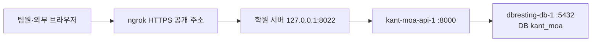

# KANT-MOA 공용 DB·학원 서버 실행 기록

> **2026-10-27 최신 운영 상태:** 홈페이지·API를 같은 서버의 Nginx로 공개 전환했다.
> 홈페이지는 기존 ngrok 주소 `/`, API는 `/api/`, Swagger는 `/api/docs`다.
> DB는 외부 `kant-moa`를 사용하며 이번 배포 전후 내용 동일을 확인했다. 아래 10/26 기록의 Docker `kant_moa`와 구분한다.
> 현재 실행·관리·복구 경로와 검증은 [최신 배포 기록](../deploy/staging/SITE.md)을 따른다.
> 현재 관리 파일은 `~/kant-moa/active-site.json`이다. 아래 과거 API 전용 Compose 시작 명령을 그대로 재실행하지 않는다.

기록일: 2026-10-26 (KST). 작업: 이상재, Codex와 함께 진행.

팀원과 각자의 에이전트가 같은 구조로 이어서 작업하기 위한 문서입니다.
**공용 DB 테이블 생성, FastAPI의 DB 연결, ngrok 외부 API 접속을 확인했습니다.**
인증·상품·주문 API나 쇼핑몰 전체 이전이 완료됐다는 뜻은 아닙니다.
기존 `PROJECT2.md`의 각자 로컬 DB 준비 안내는 개인 개발용으로 유지하고,
공용 서버의 현재 적용 상태는 이 문서를 기준으로 봅니다.

## 1. 완료한 것과 남은 것

| 항목 | 상태·근거 |
|---|---|
| 전용 DB·계정 | `kant_moa` / `kant_moa` 생성. 기존 `dbresting` DB와 분리 |
| 공용 테이블 | `public`에 18개, 소유자 모두 `kant_moa`. 사용자 실행 결과의 목록 확인 |
| 초기 생성 SQL | [backend/sql/001_create_tables.sql](../backend/sql/001_create_tables.sql), 서버 적용 결과 `COMMIT` 확인 |
| 카탈로그 시드·이미지 이관 | 이번 작업에서 미실시. 테이블 생성 SQL에는 데이터 INSERT 없음 |
| FastAPI | `kant-moa-api-1` 컨테이너가 healthy, 서버 `/health`에서 DB 연결 성공 |
| 외부 공개 | ngrok `/health`·`/docs` HTTP 200. 사용자 브라우저에서 Swagger 표시 확인 |
| 실제 등록 API | 외부 `/openapi.json` 재확인 결과 `/health`만 등록 |
| 일반 로그인 + Google 로그인 | 사용자 선택으로 두 방식 병행. 컬럼만 준비됐으며 P1 구현·계정 연결 정책은 후속 |
| JWT·블랙리스트·ADMIN 검사 | 기능 구현·통합·실제 토큰 검증은 후속 |
| 상품·주문·관리자 API·화면 연동 | 후속. 서버에 최신 소스가 있어도 라우터 등록·실행 확인 전에는 API 완료로 보지 않음 |
| 팀원 PC에서 공용 DB 직접 접속 | 미설정. 현재 DB는 Docker 내부 네트워크에서만 접근 |
| ngrok 상시 실행 | `kant-moa-ngrok.service` 등록. enabled·active (running), 전환 후 외부 `/health` HTTP 200 확인 |
| Next.js 서버 실행 | 미실시. 기존 프론트에는 Supabase 의존성이 남아 있음 |

## 2. 접속 주소와 배치

| 항목 | 값 |
|---|---|
| 학원 서버 SSH | `ssh kant@10.2.10.104`, 비밀번호 로그인 |
| SSH 접근 확인 | 이번 작업 PC에서 접속 성공. 집·다른 네트워크에서 동일 IP 접속은 보장하지 않음 |
| 공개 API 기본 주소 | https://letdown-kilometer-nutcase.ngrok-free.dev |
| 공개 Swagger | https://letdown-kilometer-nutcase.ngrok-free.dev/docs |
| 공개 상태 확인 | https://letdown-kilometer-nutcase.ngrok-free.dev/health |
| FastAPI 호스트 주소 | 학원 서버의 `http://127.0.0.1:8022` |
| FastAPI 컨테이너 포트 | `8000`, 호스트 `127.0.0.1:8022`로 연결 |
| ngrok 관리 화면 | 학원 서버의 `http://127.0.0.1:4040`. 개인 PC localhost가 아님 |
| PostgreSQL 컨테이너 | 기존 `dbresting-db-1`, PostgreSQL 18 |
| DB 네트워크 | 기존 `dbresting_default`, external network로 재사용 |
| DB 호스트·포트 | 같은 Docker 네트워크 안에서 `dbresting-db-1:5432` |
| KANT-MOA DB·사용자·스키마 | `kant_moa` / `kant_moa` / `public` |



**ngrok HTTPS 주소는 웹·API용입니다. PostgreSQL 접속 주소가 아닙니다.**
`10.2.10.104:8022`도 현재는 localhost 바인딩이라 다른 PC에서 직접 접속하지 못합니다.
개인 PC에서 `127.0.0.1:8022`나 `127.0.0.1:4040`을 열면 개인 PC 자신을 가리킵니다.
기존 다른 프로젝트의 호스트 `5433`, `8000`, `8021`, `8081`을 우리 서비스 주소로 사용하지 않습니다.

## 3. 서버 파일 위치와 소스 기준

```text
/home/kant/kant-moa/
├── app/                      # Git clone한 KANT_MOA_develop
│   └── backend/
├── db/
│   └── 001_create_tables.sql # 최초 적용한 SQL 복사본
├── Dockerfile.backend        # deploy/staging에서 복사
├── compose.backend.yml       # deploy/staging에서 복사
├── backend.env               # 비밀: DATABASE_URL, chmod 600
└── ngrok.yml                 # 비밀: 개인 ngrok authtoken, chmod 600
```

- 서버 clone 당시 `main` 커밋: `9ff2018` (P4 PR #1 병합).
- SQL 작성 당시 로컬 커밋: `51c5aec3c30134ad1c2efa65513158f358fa5148`.
- SQL·배포 파일은 당시 미커밋 상태에서 SCP로 전달했습니다. 서버 clone만으로 받은 파일이 아닙니다.
- 초기 SQL의 로컬 전달 파일 SHA-256:
  `BF87BD8E904EA98FEA18CEB7D98E6A5EB7375388BE951C6752D65AF5A3CCD819`.
  서버 파일 해시를 별도로 조회·대조한 기록은 없습니다.
- 이 문서와 파일을 push해도 서버 코드는 자동 갱신되지 않습니다. 서버 소스 갱신과 이미지 재빌드가 필요합니다.
- 컨테이너의 업로드 데이터는 `kant-moa_uploads_data` named volume에 보관합니다.
  고정 이미지는 이미지 빌드 시 `backend/assets`에서 복사합니다.

## 4. 적용된 테이블 구조

기존 Supabase 공개 테이블 17개에서 `profiles`를 `users`로 바꾸고
`token_blacklist`를 추가한 18개입니다. 상세 자료형·NULL·기본값·PK/FK·CHECK의
실제 생성 기준은 [적용 SQL](../backend/sql/001_create_tables.sql)입니다.

| 담당 영역 | 테이블 |
|---|---|
| P1 회원·인증 | `users`, `token_blacklist` |
| P2 상품·카탈로그 | `artists`, `artist_members`, `categories`, `products`, `product_variants`, `product_images` |
| P2 좋아요·콘텐츠 | `wishlists`, `artist_likes`, `artist_banners`, `home_banners`, `notices` |
| P3 구매·배송 | `cart_items`, `addresses`, `orders`, `order_items` |
| 공통 설정 | `shop_settings` (시드·조회 소유자는 P2/P3 합의 필요) |

### 회원과 FK

| users 컬럼 | 현재 적용 상태 |
|---|---|
| `id` | UUID PK, 기본값 `gen_random_uuid()` |
| `google_sub` | TEXT, UNIQUE, NULL 허용 |
| `email` | TEXT, NOT NULL, UNIQUE |
| `password_hash` | TEXT, NULL 허용 |
| `nickname` | TEXT, NOT NULL |
| `phone` | TEXT, NULL 허용 |
| `role` | TEXT, 기본 USER, USER/ADMIN CHECK |
| `created_at` | TIMESTAMPTZ, 기본 `now()` |

일반 로그인 회원은 password_hash, 구글 회원은 google_sub를 사용하고,
명시적 계정 연결 후에는 둘 다 보유할 수 있습니다. **둘 중 하나 이상 필수라는
조건은 현재 DB CHECK로 추가하지 않았으므로 P1에서 검증 또는 후속 마이그레이션이 필요합니다.**
같은 이메일을 가진 계정을 자동 연결하는 정책은 구현하지 않았습니다.
`cart_items`, `addresses`, `orders`, `wishlists`, `artist_likes`의 user_id는
모두 `users.id`를 참조합니다. Supabase `auth.users`·`profiles` 참조가 없습니다.
`token_blacklist`는 `jti` PK와 `expires_at`으로 구성됩니다.

### 기존 테이블에서 유지한 내용

- 옵션 단위 재고·구매 제한: `product_variants.stock`, `max_per_user`.
- 후속 컬럼 포함: `products.is_limited/is_preorder/release_date`, `artists.tagline`,
  `product_images.kind`, `orders.shipping_fee/is_direct`.
- `max_per_user` 기본값 4, 단 기존 CHECK는 NULL 또는 양수를 허용합니다.
- 주문 당시 상품명·옵션명·단가·배송지 스냅샷 유지. 주문 총액은 배송비 포함.
- 찜·아티스트 좋아요 복합 PK, 장바구니 사용자+옵션 UNIQUE, 가격·재고 음수 금지와 수량 양수 CHECK.
- 사용자별 기본 배송지는 부분 UNIQUE 인덱스로 **최대 1개**. 반드시 1개 존재까지 보장하지 않음.
- `products.status`의 `on_sale/sold_out/hidden` 유지. 재고에 따른 품절 응답 계산과 수동 상태의 관계는 P2/P4 확정 후 코드로 반영.

이 작업은 테이블·기본 무결성만 준비했습니다. 데이터 INSERT, 비즈니스 RPC,
인증/배송지 트리거, Supabase RLS/GRANT, 추가 조회 인덱스, 재고 잠금은 적용하지 않았습니다.
행 잠금용 새 테이블·is_locked 컬럼은 필요하지 않습니다.

## 5. 각 에이전트가 이어서 작업할 때

1. **먼저 최신 팀 브랜치와 이 문서·적용 SQL을 읽습니다.** 공유 DB에 초기 SQL을 다시 실행하거나
   ORM `drop_all/create_all`로 구조를 덮어쓰지 않습니다. `create_all`은 기존 테이블 컬럼을 변경하는 도구가 아닙니다.
2. 기존 테이블에 맞는 SQLAlchemy 모델을 `database.Base` 기반으로 구현합니다.
   ENUM을 쓰려면 현재 TEXT+CHECK와 호환 또는 명시적 마이그레이션이 필요합니다.
3. 재현 가능한 개인 테스트는 각자 로컬 Docker DB에서 하고, 같은 초기 SQL을 **빈 DB에 한 번** 적용합니다.
   로컬 `compose.yaml` 기본 DB/사용자는 `kantmoa`이며 서버의 `kant_moa`와 이름이 다릅니다.
   접속 URL은 각자의 실제 설정에 맞춥니다.
4. 각 담당자가 로컬 Docker DB에서 검증하고 PR 리뷰·병합을 마친 후속 마이그레이션을 공용 DB에 직접 적용합니다.
   최초 Alembic 이력은 실제 스키마와 비교해 P1과 먼저 맞춥니다. 이후 적용 전 변경 내용·시점을 공유하고
   한 번에 한 명씩 적용하며, 적용 후 버전·검증 결과를 기록합니다. 마이그레이션 head가 갈라지면 먼저 정리합니다.
   공용 DB 초기화·초기 SQL 재실행·실패/동시성 실험으로 다른 팀원의 데이터를 덮어쓰지 않습니다.
5. Repository는 비동기 AsyncSession과 ORM↔도메인 변환을 직접 구현합니다.
   공용 DB를 사용한다는 이유로 과제의 개인별 구현·검증이 대체되지는 않습니다.
6. P2가 공통 재고 잠금 조회·저장을 제공하고 P3/P4가 같은 세션에서 사용합니다.
   `get_variants_for_update(variant_ids)`는 ID 오름차순 잠금, commit/rollback은 각 응용 서비스가 소유하는 계약입니다.
   P4의 `VariantStockPort` 실제 연결은 후속이며, 서버에 구현됐다고 가정하지 않습니다.
7. P1은 두 로그인 방식, 내부 UUID, JWT/블랙리스트·USER/ADMIN,
   get_current_user/require_admin과 계정 연결 정책을 구현·공유합니다.
   Google 로그인만으로 비밀번호 해싱 과제 요건이 충족되는 것은 아닙니다.
8. 현재 CORS 기본값은 `http://localhost:3000`입니다. 다른 프론트 주소·ngrok 안내 우회 헤더를
   사용하는 요청은 허용 origin/header와 함께 검토합니다. 이번 작업에서 CORS 범위를 넓히지 않았습니다.
9. 현재 공개 Swagger에는 `/health`만 있습니다. 기능 라우터를 main에 등록하고
   서버 소스 갱신·재빌드한 뒤 실제 요청과 DB 결과로 완료를 확인합니다.

### 팀원 PC의 DB 연결은 아직 별도 작업

공용 서버의 FastAPI는 Docker 내부 DB에 연결돼 있지만, 각자의 로컬 FastAPI가 같은 DB에
직접 연결되는 경로는 아직 없습니다. HTTP ngrok 도메인을 DATABASE_URL에 넣으면 안 됩니다.
SSH 터널용 호스트 포트 또는 별도 승인된 접근 경로를 서버 담당자와 마련해야 합니다.
현재 Docker 내부 IP를 고정 DB 주소로 공유하지 않습니다.

## 6. 서버 조회·재배포 명령

아래는 **학원 서버 SSH 터미널**에서 실행합니다. Windows PowerShell 경로를 서버에 입력하지 않습니다.

```bash
cd ~/kant-moa
docker compose -f compose.backend.yml ps
curl --fail --silent --show-error http://127.0.0.1:8022/health
```

정상 응답:

```json
{"status":"ok","database":"ok"}
```

테이블·소유자 조회(비밀값 출력 없음):

```bash
docker exec dbresting-db-1 sh -c 'psql -X -U "$POSTGRES_USER" -d kant_moa -P pager=off -c "SELECT tablename, tableowner FROM pg_tables WHERE schemaname = '\''public'\'' ORDER BY tablename;"'
```

코드 업데이트는 서버 작업 트리 상태를 확인하고 **배포할 커밋/브랜치를 팀에서 정한 뒤** 진행합니다.
자동 배포나 모든 커밋 자동 pull은 설정하지 않았습니다. 필요한 변경을 서버에 반영한 후:

```bash
cd ~/kant-moa
docker compose -f compose.backend.yml up -d --build api
docker compose -f compose.backend.yml ps
curl --fail --silent --show-error http://127.0.0.1:8022/health
```

배포 파일을 변경했다면 저장소 `deploy/staging`의 두 파일을 서버 `~/kant-moa/`에도 복사해야 합니다.
현재 Compose는 `./app/backend`를 build context로 사용하고 외부 `Dockerfile.backend`를 참조합니다.
단순 restart로는 이미지에 복사된 소스가 갱신되지 않습니다. 최신 실행 로그는 서버에서 확인하되
공유 전 비밀번호·URL·토큰·개인정보가 포함되지 않았는지 확인합니다.

중지는 `docker compose -f compose.backend.yml stop api`입니다.
이 Compose에는 KANT-MOA API만 정의돼 있습니다. **기존 dbresting Compose에서 down/reset을 실행하지 않습니다.**
`dbresting-db-1`을 재시작하면 같은 PostgreSQL을 사용하는 다른 서비스에도 영향이 있습니다.

## 7. ngrok 실행 상태와 외부 검증

ngrok 3.39.13(`/snap/bin/ngrok`)이 기존에 설치돼 있어 재설치하지 않았습니다.
기본 설정을 덮어쓰지 않고 `~/kant-moa/ngrok.yml`에 사용자 토큰을 별도 저장했습니다.
설정 파일 검사 성공 후 아래 명령으로 실행했습니다.

```bash
ngrok http http://127.0.0.1:8022 --url https://letdown-kilometer-nutcase.ngrok-free.dev --config "$HOME/kant-moa/ngrok.yml"
```

- 위 명령은 최초 포그라운드 검증용입니다. 이후 수동 실행을 종료하고 systemd 서비스로 전환했습니다.
- 서비스 파일: `/etc/systemd/system/kant-moa-ngrok.service`. `User=kant`로 기존 전용 설정을 읽습니다.
- `systemctl enable --now` 후 enabled·active (running)을 사용자 출력으로 확인했습니다.
  SSH 종료와 무관하게 실행하며, 부팅 시 시작하고 프로세스 종료 시 10초 후 재시작하도록 설정했습니다.
  실제 서버 재부팅 테스트는 하지 않았습니다.
- 서비스 전환 후 외부 `/health` HTTP 200 및 `{"status":"ok","database":"ok"}`를 다시 확인했습니다.
- 상태: `systemctl status kant-moa-ngrok.service --no-pager`
  / 로그: `sudo journalctl -u kant-moa-ngrok.service -n 30 --no-pager`
  / 재시작: `sudo systemctl restart kant-moa-ngrok.service`
  / 중지: `sudo systemctl stop kant-moa-ngrok.service`.
- 기존 터널이 실행 중이면 중복 실행하지 않습니다. 다른 사람의 ngrok 프로세스나 기본 설정을 변경하지 않습니다.
- 터미널의 `solaris` 색상 UI 경고가 있었지만 외부 HTTP 검증은 성공했습니다.
- 무료 플랜의 브라우저 안내가 나오면 Visit Site로 진입합니다.
- 검증용 HTTP 요청에는 `ngrok-skip-browser-warning: true` 헤더를 사용했습니다.
  프론트 fetch에 추가할 경우 CORS의 허용 헤더도 함께 확인합니다.
- ngrok 토큰은 사용자 직접 입력, 설정 파일 600. 토큰을 문서·소스·스크린샷에 넣지 않았습니다.

Codex 외부 읽기 요청으로 확인한 결과:

| 요청 | 결과 |
|---|---|
| `/health` | HTTP 200, `{"status":"ok","database":"ok"}` |
| `/docs` | HTTP 200, `KANT MOA Project 2 API - Swagger UI` |
| `/openapi.json` | HTTP 200, 등록 경로 `/health` |

사용자도 외부 브라우저에서 Swagger를 확인했습니다. `/health`의 SELECT 1 성공은 연결 증빙이며,
모든 테이블 제약·기능 E2E·상품 데이터가 검증됐다는 뜻은 아닙니다.

## 8. 검증 기록과 다음 작업

- 적용 전 별도 임시 PostgreSQL 18에서 SQL 실행: 18개 테이블·18개 FK 생성 확인.
- 같은 SQL 재실행 시 기존 테이블 오류로 중단하고 테이블을 교체하지 않는 것 확인.
- 서버에서는 사용자 실행 결과로 CREATE ROLE/CREATE DATABASE, SQL COMMIT,
  18개 테이블의 소유자 `kant_moa`, API healthy·DB 응답을 확인했습니다.
- Compose 형식 검사에서 API만 정의, localhost 8022, external DB network,
  업로드 named volume을 확인했습니다. 실제 서버 이미지 빌드·기동도 사용자 결과로 확인했습니다.
- 기능 테스트·로그아웃 401·관리자 403·재고 동시성·프론트 E2E는 미실시입니다.

남은 작업:

- [ ] 각 담당자가 현재 테이블과 ORM/도메인/API 계약을 맞추기
- [ ] P1: 일반+구글 인증 구현, JWT·블랙리스트·권한·관리자 생성
- [ ] P2: 시드·이미지, 상품/좋아요 API와 공통 재고 잠금·저장 제공
- [ ] P3/P4: 같은 AsyncSession 기반 재고·트랜잭션 통합, 실제 실패·권한 검증
- [ ] 팀원 PC의 공용 DB 접속 경로 마련
- [x] ngrok systemd 상시 실행·부팅 자동 시작 등록 및 전환 후 외부 상태 확인 (실제 재부팅 테스트 미실시)
- [ ] Next.js 실행·새 API 연결·Google 콜백 URL·CORS 확정
- [ ] 스키마 변경·백업·재배포 담당과 절차 확정

## 관련 파일

- [프로젝트2 공통 계약](PROJECT2.md)
- [테이블 생성 SQL](../backend/sql/001_create_tables.sql) / [신규 DB 적용 안내](../backend/sql/README.md)
- [Dockerfile](../deploy/staging/Dockerfile.backend) / [서버 Compose](../deploy/staging/compose.backend.yml)
- [배포 파일 사용 안내](../deploy/staging/README.md)
- [Slack 공유 문안](SLACK_UPDATE_2026-10-26.md)

DB 비밀번호·실제 DATABASE_URL·SSH 비밀번호·ngrok 토큰은 이 문서에 포함하지 않습니다.
실제 비밀 환경 파일은 서버 소스 폴더 밖에 유지합니다.
